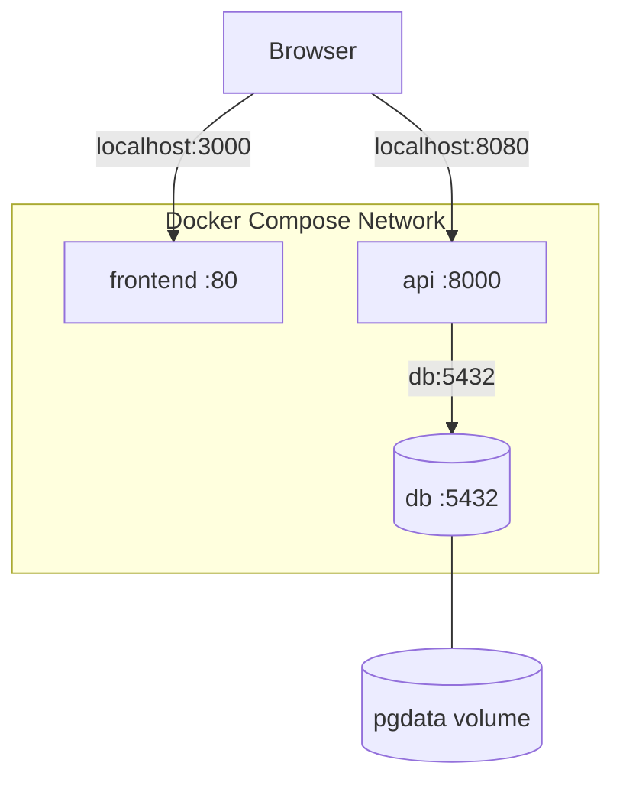

# Local Stack

This diagram shows the frontend, API, and PostgreSQL database in a Docker Compose environment.

**Figure 1.** Local application stack showing published ports, internal database communication, and persistent storage. 
